# RebarFlow

Planillas de despiece de acero de refuerzo (Bar Bending Schedule, BBS) en Python: interfaz gráfica de escritorio, un
catálogo de 14 plantillas de forma (una de ellas para formas dibujadas a mano), cálculo de longitudes de corte, pesos y largo de
ganchos, **plan y secuencia de corte optimizados** para reducir el desperdicio, y exportación a **Excel** y **PDF** con el
dibujo de cada barra.

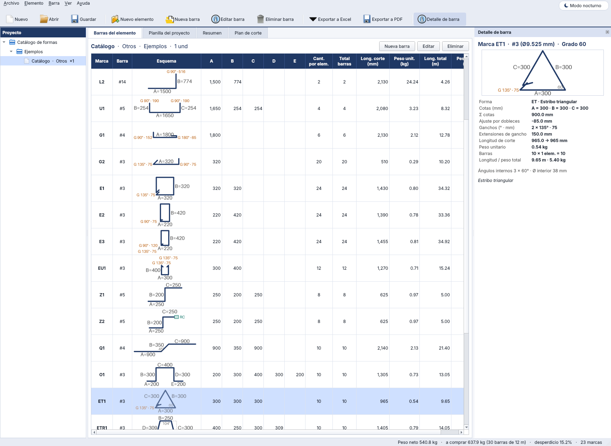

## Uso rápido

```bash
pip install -e ".[dev]"      # openpyxl, pillow, reportlab, PySide6 y pytest (solo la app: ".[gui]")
python -m gui                # interfaz gráfica (también: rebarflow, o rebarflow ruta/proyecto.rebarflow)
python main.py               # ejemplo por consola: escribe output/planilla_bbs.xlsx y .pdf
pytest
```

En Linux, PySide6 necesita las librerías del sistema de Qt (`libegl1`, `libxkbcommon0`, `libdbus-1-3`, `libfontconfig1`).
Para usar solo el motor y los exportadores (sin interfaz) basta `pip install -e .`.

```python
from core.element import ElementType, StructuralElement
from core.rebar import get_rebar
from core.shape_codes import Stirrup, UBar
from core.shape_templates import CrankBar
from engine.bbs_calculator import BBSCalculator
from exporters.excel_exporter import ExcelExporter
from exporters.pdf_exporter import PdfExporter

viga = StructuralElement("V-101", ElementType.BEAM, "Nivel 1", quantity=4)
n3, n4, n6 = get_rebar("#3"), get_rebar("#4"), get_rebar("#6")
viga.add_group("A2", n6, UBar.with_standard_hooks(n6, a=5500), 2, "Refuerzo superior")
viga.add_group("A3", n4, CrankBar(a=900, b=350, c=900, angle=45), 6, "Barra levantada")
viga.add_group("E1", n3, Stirrup(220, 420), 38, "Estribos")

resultado = BBSCalculator(stock_length_mm=12_000).calculate([viga])
ExcelExporter(project_name="Mi proyecto").export(resultado, "planilla.xlsx")
PdfExporter(project_name="Mi proyecto", page_size="a4").export(resultado, "planilla.pdf")
```

## Ejecutable de Windows (.exe)

`RebarFlow-Windows.zip` contiene `RebarFlow\RebarFlow.exe` (aplicación gráfica de 64 bits, sin instalar Python ni
dependencias): descomprima **toda** la carpeta y abra el `.exe`. Requiere Windows 10 (1809+) o Windows 11. Al no estar
firmado, SmartScreen puede avisar: «Más información» → «Ejecutar de todas formas».

Para reconstruirlo:

* **En Windows**: `packaging\build_windows.bat` (crea un entorno virtual, instala dependencias, genera el icono y
  ejecuta PyInstaller con `packaging/rebarflow.spec`); deja `dist\RebarFlow-Windows.zip`.
* **En GitHub**: ejecute el workflow *Build Windows executable* (pestaña Actions → Run workflow); corre las pruebas,
  compila, ejecuta `RebarFlow.exe --self-test` y publica el `.zip` como artefacto.

`RebarFlow.exe --self-test CARPETA` abre la ventana con el proyecto de ejemplo, exporta Excel, PDF y proyecto, guarda una
captura y escribe `self-test.txt` con el resultado; sirve para comprobar un `.exe` recién compilado.

## Catálogo de formas

El catálogo sigue el modelo de formas de Revit: cada forma es de **estilo** «barra» o «estribo/ligadura» (decide el diámetro
de doblez y los ganchos estándar) y sus extremos admiten ganchos de **90°, 135° o 180°**. En la interfaz se elige de una
galería con miniatura, y el formulario se genera solo a partir de los parámetros de cada plantilla. Las barras van de la
**#3 a la #11 y la #14** (ASTM A615, Ø43 mm, 11.38 kg/m).

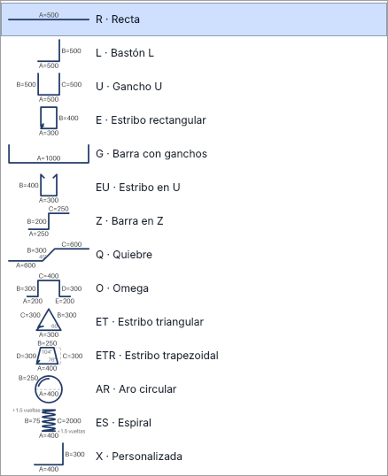

| Código | Plantilla | Notas |
|---|---|---|
| `R` | Recta | |
| `L` | Bastón L | un doblez a 90°; la pata corta se informa como gancho |
| `U` | Gancho U | dos dobleces a 90° del mismo lado |
| `G` | **Barra con ganchos** | 0°, 90°, 135° o 180° en cada punta; mismo lado u opuestos; estilo barra o estribo |
| `E` | **Estribo rectangular cerrado** | un solo estribo; cada pata (gancho inicial y final) a 90° o 135°, con su propia extensión |
| `EU` | **Estribo abierto en U** | cada punta a 90° o 135° |
| `Z` | **Barra en Z** | dos dobleces a 90° en sentidos opuestos |
| `Q` | **Quiebre** | tramo inclinado a 5°–85° (barra levantada) |
| `O` | **Omega (Ω)** | ala, pata, tramo superior, pata y ala |
| `ET` / `ETR` | **Estribo triangular / trapezoidal** | ángulos internos distintos de 90°; cada pata a 90° o 135° |
| `AR` | **Aro circular** | traslape y/o ganchos de 90° o 135° en cada extremo; sin ganchos coincide con el código 75 de BS 8666 |
| `ES` | **Espiral** | vueltas adicionales al inicio y al final por separado, ganchos de 90° o 135° en cada extremo; se suministra en rollo |
| `X` | **Personalizada** | tramos y ángulos definidos a mano |

> Se buscó el catálogo numerado de formas de Revit pero no se pudo consultar (la búsqueda solo devolvió la
> documentación de su API); el conjunto sigue su modelo (estilos barra/estribo, ganchos 0/90/135/180°, espiral y círculo
> con traslape) y las familias habituales de BS 8666 y ACI. Agregar otra forma toma pocas líneas (ver más abajo).

### Referencia de las cotas en el dibujo

Cada cota del esquema lleva su **letra de referencia** (`A=400`, `B=300`…), la misma que encabeza su columna en la planilla,
el panel de detalle y los formularios. Una cota repetida (los lados iguales de un estribo) se rotula una sola vez; los ángulos
internos distintos de 90° van en gris (`60°`) y las vueltas adicionales de una espiral como `+1.5 vueltas`. La altura del estribo
trapezoidal (cota C, que no es un lado) se acota con una línea punteada.

### Estribos, aros y espirales: ganchos en cada extremo

Hay **un solo estribo rectangular** (`E`): cada pata se configura por separado con *Gancho inicial* y *Gancho final* (90° o 135°) y
su extensión (vacía = estándar de la norma), de modo que sirve para el estribo sísmico a 135°, el de 90° y el mixto de 135°/90°.
Los estribos en U, triangular y trapezoidal tienen los mismos cuatro parámetros. Con extensiones distintas el dibujo rotula
cada una con su ángulo (`G 135° · 75` junto al último lado y `G 90° · 120` bajo el primero); el panel de detalle y el diálogo las detallan (`135° · 75 / 90° · 120`).

El **aro circular** admite traslape (`B`, 0 si no hay) y un gancho de 90° o 135° en cada extremo, doblado hacia el interior:
`L = π·(D − d) + traslape + Σ (φ·R + extensión)`. La **espiral** admite vueltas planas adicionales al inicio y al final por
separado (ACI 318 pide 1.5 en cada extremo) y los mismos ganchos. Un archivo guardado con el estribo `E90` o con un solo
`hook` se abre sin cambios: se convierte al estribo único.

| Estribo con patas distintas | Aro con ganchos | Espiral con vueltas y ganchos |
|---|---|---|
| 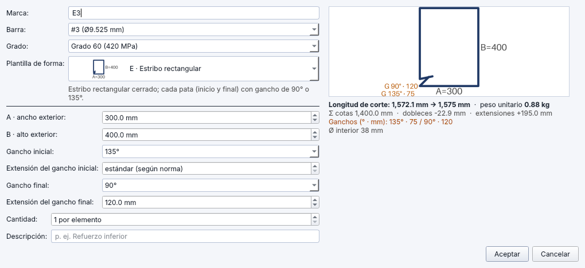 | 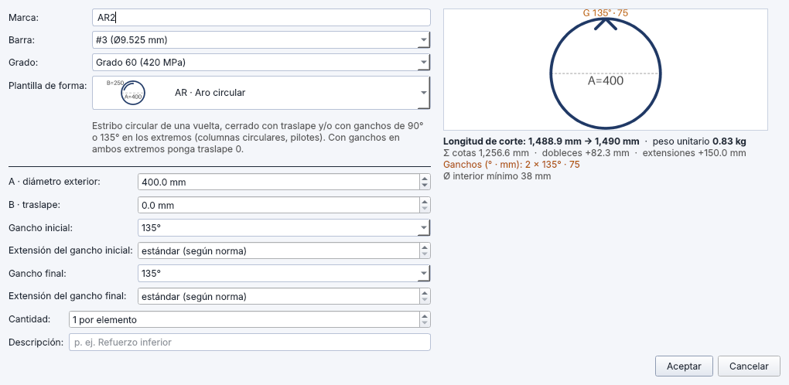 | 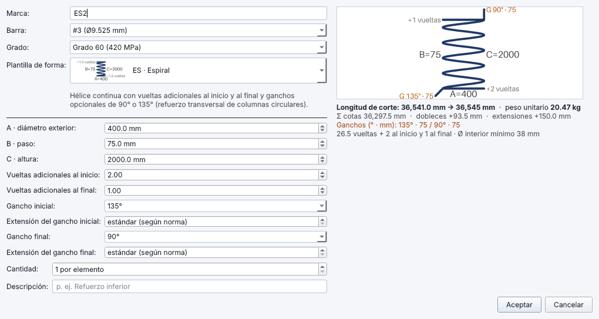 |

### Largo de los ganchos

Cada gancho se anota con su **ángulo y su extensión recta** (la «pata» después del doblez): en el dibujo, como un rótulo ámbar
`G 135° · 75` (uno por gancho si difieren; en un aro, sobre el punto de cierre); y en el diálogo de la barra y el panel de detalle, como **Ganchos (° · mm)** (`2 × 135° · 75`, `90° · 152 / 180° · 65`).
Las tablas de la planilla no llevan columna de ganchos: el dibujo ya los rotula. Si la extensión queda bajo el mínimo de la norma,
la marca sale en **rojo** (con el aviso en su ayuda emergente) y Excel y PDF listan el texto en un bloque *Avisos* bajo la
planilla. Con una extensión vacía se usa la estándar.

### Couplers (rosca corta y rosca larga)

Las barras que no terminan en gancho admiten un **coupler** en cada extremo libre (recta, bastón L por el extremo de A, barra con
ganchos con el extremo en «Sin gancho», Z, quiebre, omega y forma personalizada). Se dibuja un **rectángulo** sobre el extremo
con su rótulo (`RC` = rosca corta, el rectángulo más corto; `RL` = rosca larga, el más largo) y se elige el tipo en *Coupler
inicial* / *Coupler final*. Un extremo con gancho (incluida la pata de una L o de una U) no admite coupler: el diálogo lo avisa.

El coupler es un accesorio: **no cambia la longitud de corte** (las cotas llegan al extremo de la barra y la rosca se labra
sobre esa longitud). Se cuenta por barra y tipo en la hoja *Resumen* (Excel, PDF e interfaz), y el encabezado de la planilla
explica `RC`/`RL`. Si su proveedor pide un sobrante por rosca o por forja del extremo, súmelo a la cota del tramo.

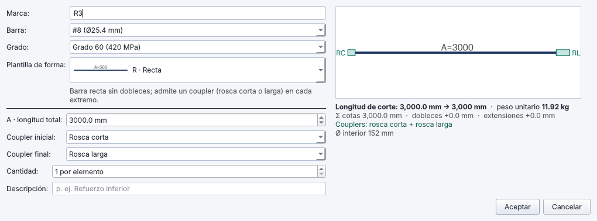

### Forma dibujada a mano

La plantilla `X · Personalizada` abre un editor de **tramos y ángulos**: cada fila es un tramo con su cota exterior y el giro
del doblez que lo une al siguiente (+ a la izquierda, − a la derecha; una L es +90° y una Z, +90° y −90°). Se pueden agregar
y quitar tramos, invertir el recorrido, reflejar los giros y añadir ganchos en los extremos; el dibujo y la longitud de
corte se recalculan al instante.

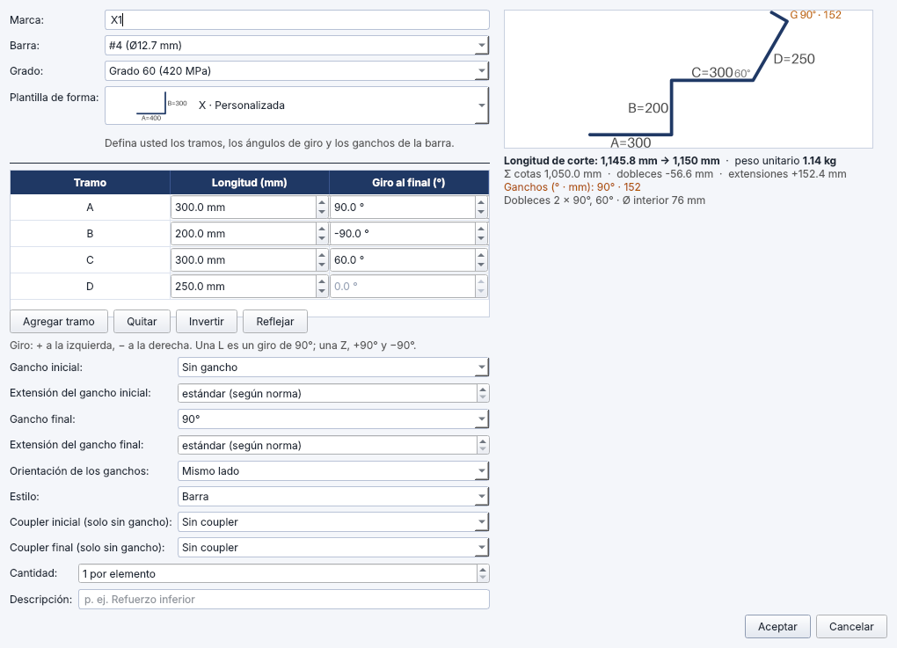

## Plan y secuencia de corte (optimización del desperdicio)

Para cada diámetro se resuelve un problema de *cutting stock* 1D: cortar todas las piezas de barras comerciales (12 m por
defecto) con el menor número de barras. Se prueban cuatro estrategias y se conserva la mejor:

| Estrategia | Idea |
|---|---|
| **LP** (Gilmore–Gomory) | resuelve la relajación lineal por generación de columnas (símplex revisado en Python puro, mochila exacta como precio), redondea hacia abajo y reparte el residuo; con un presupuesto de tiempo |
| **SHP** | patrones de sobrante casi nulo repetidos y el resto por Best Fit |
| **BFD** / **FFD** | Best Fit / First Fit Decreasing, más un paso que intenta vaciar la barra más libre |

Resultados medidos (`tests/test_cutting_optimizer.py`): coincide con el **óptimo exacto** (programación dinámica por
subconjuntos) en todas las instancias pequeñas probadas; con 20 546 piezas de 40 longitudes distintas baja de 6953 barras
(First Fit, 2.39 % de sobrante) a **6821 (0.50 %)**, a 3 barras de la cota teórica del problema lineal (6817.7), en ~1 s.
Los resultados se guardan en caché para no recalcular lo que no cambió.

El resultado es una **secuencia de corte**: patrones numerados (cuántas barras se cortan igual, de cuál a cuál, en qué orden
salen las piezas) con la barra dibujada, las marcas a las que sirve cada pieza y el retal de cada barra. Los retales de
al menos *N* mm (por defecto 1 000, configurable en las propiedades del proyecto) se cuentan como **reutilizables** y el resto
como desperdicio definitivo. Las espirales se suministran en rollo y no generan retales. Además se compara la longitud
comercial (6, 9 y 12 m) y se recomienda la que menos acero compra.

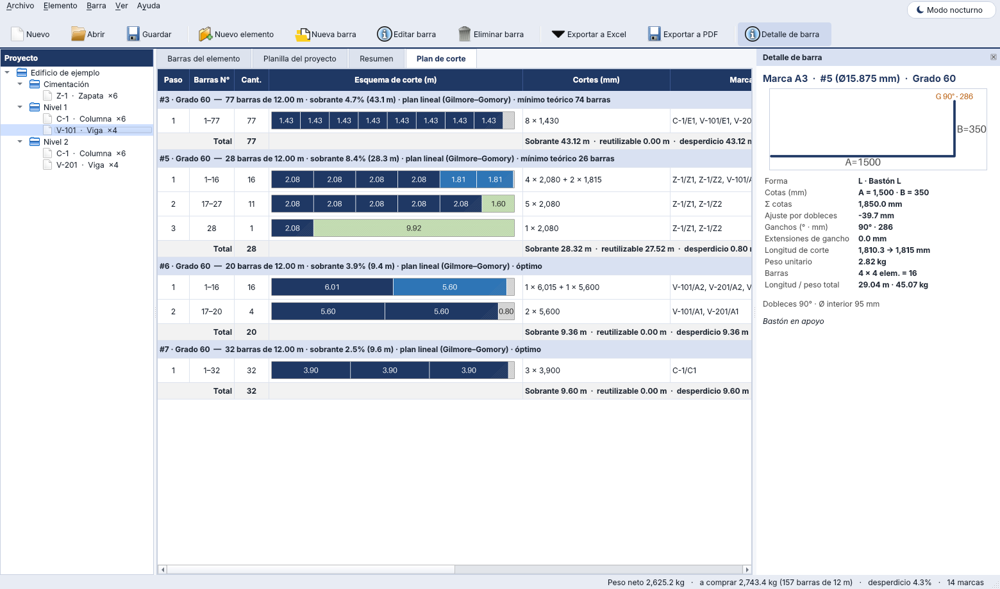

## Interfaz gráfica

* **Árbol del proyecto** (nivel → elemento); el tipo de elemento puede ser viga, columna, zapata, losa, muro u **otros**.
* **Barras del elemento**: tabla con el dibujo de cada forma, sus cotas y el largo de los ganchos.
* **Diálogo de barra** con vista previa en vivo: muestra el esquema, la longitud de corte (Σ cotas, ajuste por dobleces,
  extensiones), el peso y los errores geométricos; no permite aceptar una barra imposible, con marca repetida o más larga que
  la barra comercial.
* **Planilla del proyecto**, **Resumen** (peso por diámetro, sobrante, retales reutilizables, consolidado por nivel y longitud
  comercial recomendada) y **Plan de corte**.
* **Modo nocturno**: el botón de la esquina superior derecha (luna / sol; también *Ver → Modo nocturno* o Ctrl+Shift+D) cambia toda
  la interfaz entre el tema claro y uno oscuro: ventana, tablas, diálogos y los esquemas de las barras (trazos claros sobre
  fondo oscuro). Se recuerda para la próxima vez; **por defecto abre en modo diurno, aunque Windows tenga el tema oscuro** (el
  tema claro fija su propia paleta en vez de heredar la del sistema). Las planillas exportadas (Excel y PDF) siempre salen en claro.
* **Panel de detalle**: dibujo grande y desglose del cálculo de la barra seleccionada. Si se cierra con su X, se vuelve a abrir
  con *Ver → Detalle de barra*, el botón «Detalle de barra» de la barra de herramientas o F4.
* Guardar/abrir proyectos (`.rebarflow`, JSON legible), propiedades del proyecto (barra comercial, redondeo, retal reutilizable,
  papel), ejemplos (*Abrir ejemplo* y *Abrir ejemplo: catálogo de formas*) y exportación a Excel y PDF. Atajos: Ctrl+N/O/S,
  Ctrl+Shift+N (elemento), Ctrl+B (barra), Ctrl+E (Excel), Ctrl+P (PDF).

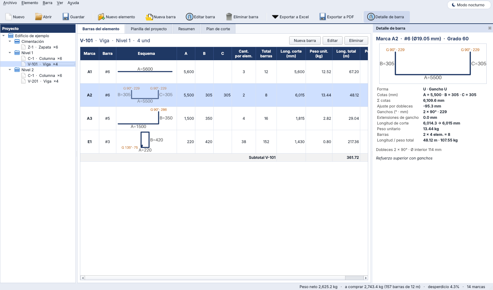

| Planilla del proyecto | Resumen |
|---|---|
| 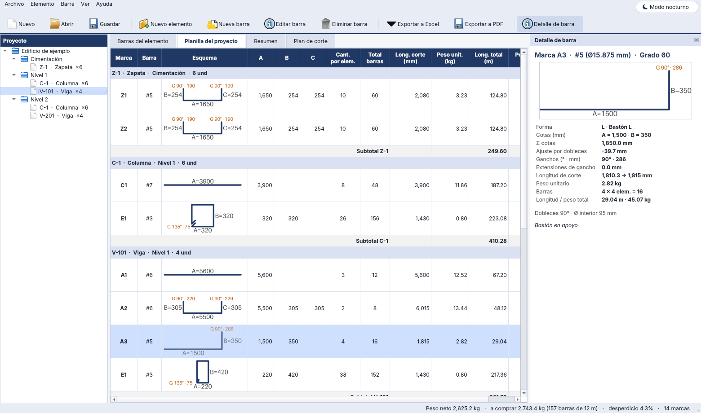 | 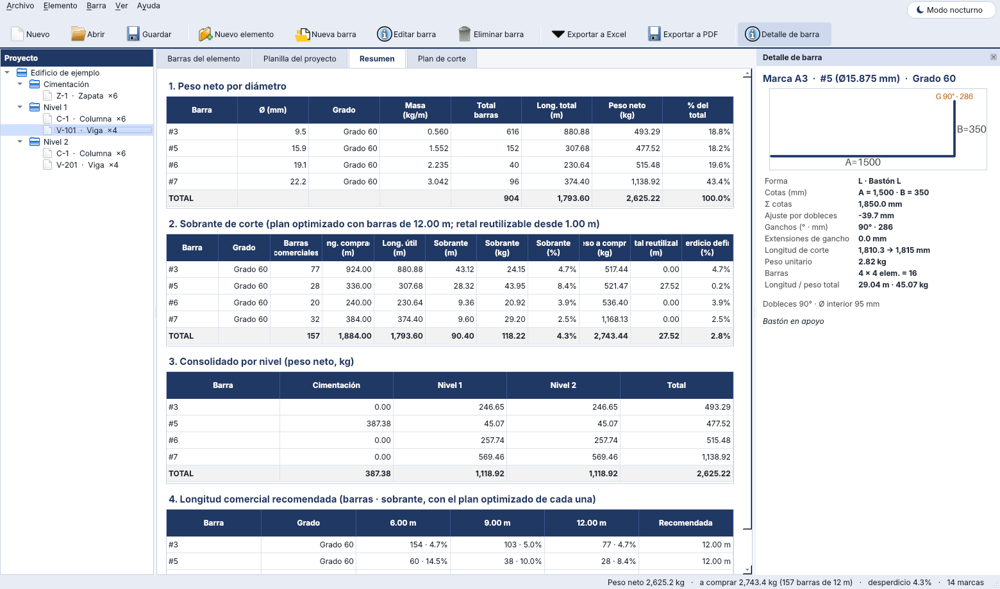 |

| Modo nocturno | Resumen y diálogo en modo nocturno |
|---|---|
| 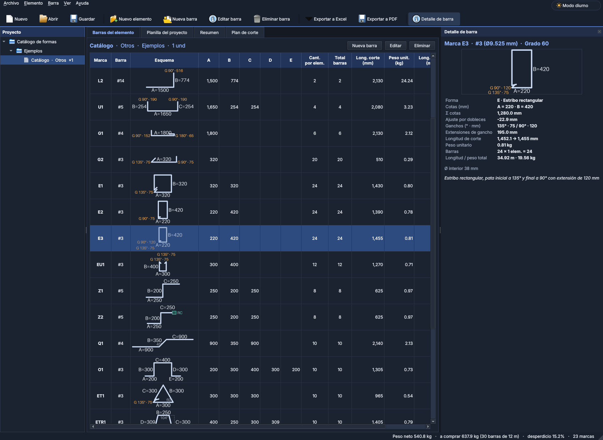 | 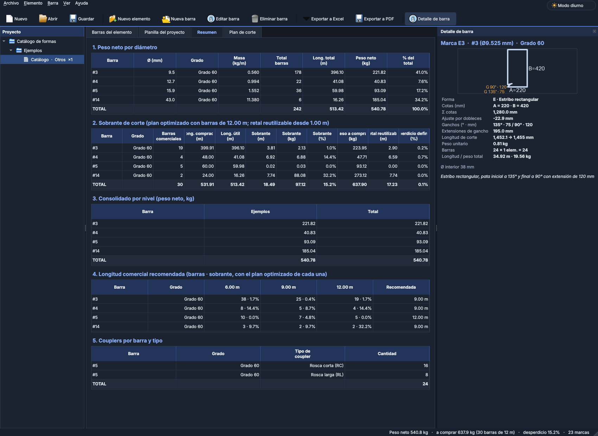 |

| Diálogo de barra | Validación geométrica |
|---|---|
| 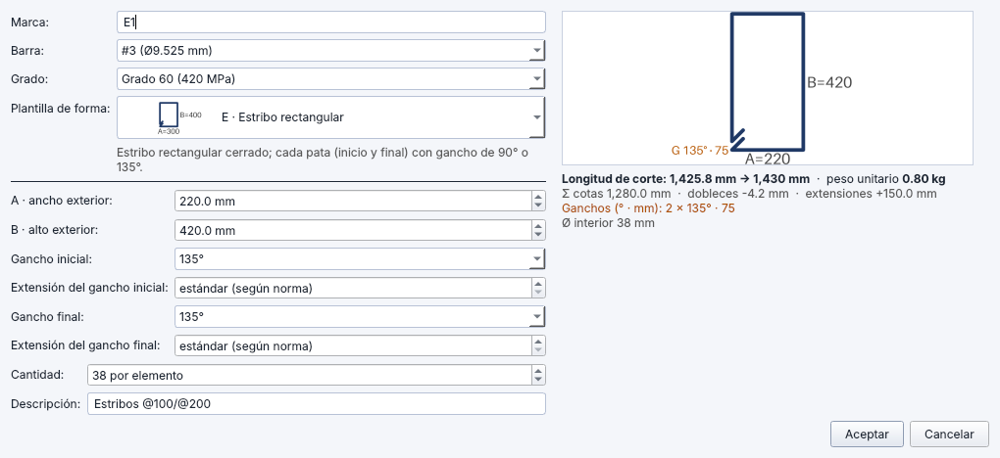 | 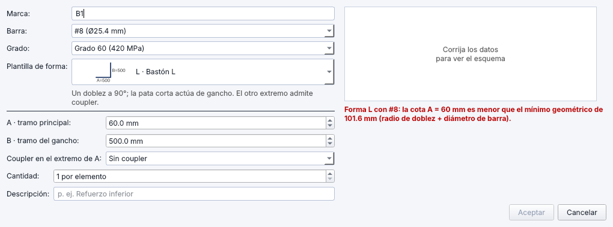 |

## Exportación con esquemas

Cada fila lleva el dibujo de su forma con las cotas, igual que las tablas de armaduras de Revit o de los programas de
despiece. El mismo renderizador (`exporters/shape_images.py`) alimenta Excel, PDF y la interfaz. Las columnas de la planilla son
*Marca, Barra, Esquema, cotas (A, B, C…), longitud de corte, cantidad por elemento, total de barras, peso unitario, longitud total y
peso total*; el diámetro, el nombre de la forma, los ganchos y las observaciones no van en la tabla (están en el dibujo, el diálogo
y el panel de detalle).

| Excel (`.xlsx`) | PDF |
|---|---|
| 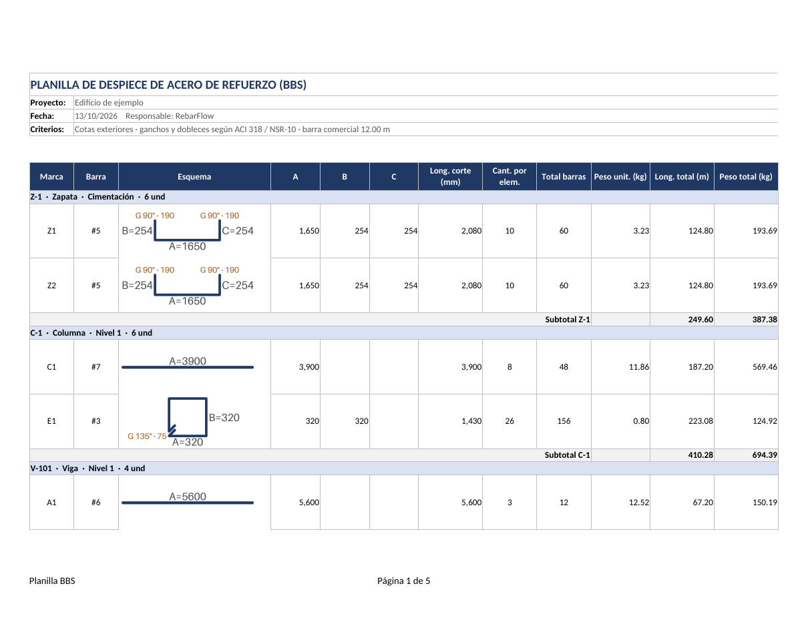 | 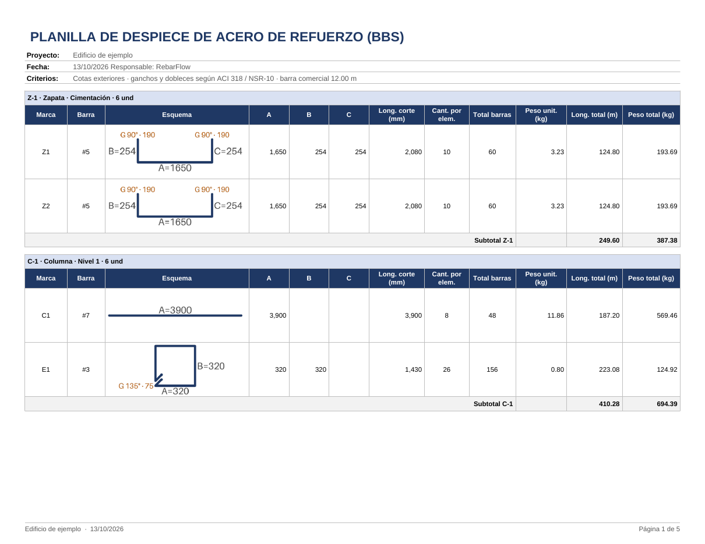 |
| 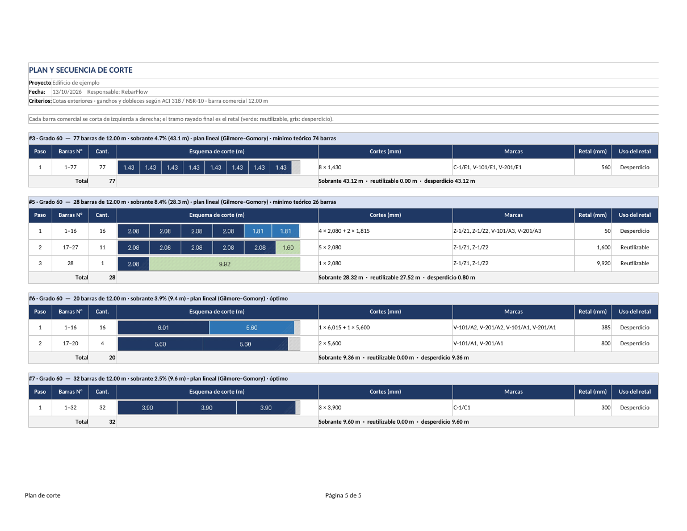 | 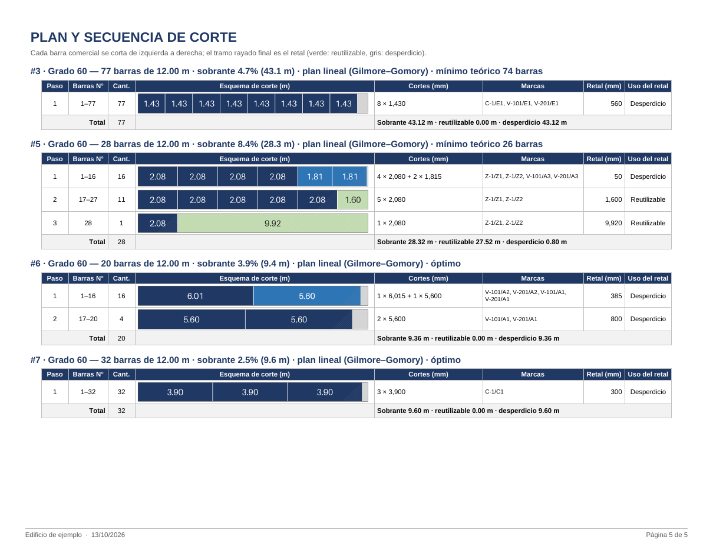 |

* **Excel**: hojas *Planilla BBS* (barras agrupadas por elemento con filas colapsables, subtotales, total general), *Resumen*
  y *Plan de corte*. Las celdas contienen valores calculados, no fórmulas, para que coincidan siempre con el motor.
* **PDF** apaisado (carta o A4): una tabla por elemento con encabezado repetido entre páginas, pie *Página X de Y*, hoja de
  resumen y páginas del plan de corte.

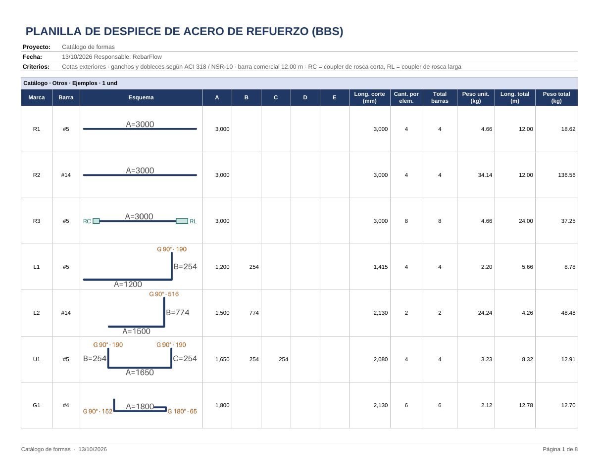

## Arquitectura

```
core/
  geometry.py       GeometryError y fórmulas de doblez (tangente, arco, deducción)
  rebar.py          Rebar, SteelGrade, ganchos estándar, radios de doblez y catálogo #3–#11 y #14
  cutlength.py      CutLength (desglose del cálculo), HookInfo (largo de cada gancho) y couplers de la barra
  coupler.py        tipos de coupler (rosca corta / larga), rótulos y leyendas
  params.py         parámetros de una forma (tipo, límites, opciones): validación y formularios
  polybar.py        motor: polilínea abierta con ganchos y polígono cerrado con ganchos (longitud y esquema)
  sketch.py         esquemas independientes del medio de dibujo (trazos, rótulos con su letra, líneas de cota)
  shape_codes.py    ShapeCode + registro extensible (con migración de códigos antiguos); R, L, U, E
  shape_templates.py  G, EU, Z, Q, O, ET, ETR, AR, ES, X
  element.py        RebarGroup (marca), StructuralElement (nivel, tipo, cantidad)
  project.py        Project: elementos + parámetros de cálculo e impresión
  serialization.py  guardado y carga de proyectos en JSON
engine/
  cutting_optimizer.py  plan y secuencia de corte (LP, SHP, BFD, FFD) y comparación de longitudes
  cutting_report.py     filas, títulos y comparativo del plan, listos para mostrar
  bbs_calculator.py     líneas de planilla, pesos por diámetro, plan de corte y consolidado por nivel
exporters/
  shape_images.py   PNG de cada forma con sus cotas y largos de gancho (Pillow)
  cutting_images.py PNG de cada barra comercial con sus piezas y su retal
  excel_exporter.py libro Excel con esquemas (openpyxl)
  pdf_exporter.py   planilla en PDF con esquemas (reportlab)
gui/                interfaz PySide6: ventana principal, diálogos, tablas, temas claro y nocturno (style.py)
sample_project.py   proyectos de ejemplo (edificio y catálogo de formas)
main.py             ejemplo por consola
packaging/          lanzador, .spec de PyInstaller, icono, build_windows.bat y LEEME del .exe
.github/workflows/  build-windows.yml: compila el .exe en GitHub Actions
tools/              capture_screenshots.py regenera las imágenes de docs/
tests/              pytest (la interfaz se prueba sin pantalla)
```

Los modelos son `dataclass` (sin dependencias extra); las validaciones viven en `__post_init__`. Las capas respetan el
sentido `core ← engine ← exporters ← gui`.

## Convenciones de cálculo

* Unidades: mm, kg y kg/m.
* **Cotas exteriores** (de fuera a fuera de la barra, como en ACI SP-66 / CRSI): cada tramo se mide entre los vértices donde se
  cortan las caras exteriores de los dobleces, proyectado sobre su eje. Con radio interior `r` y diámetro `d`, un doblez de giro θ
  consume del tramo vecino la tangente exterior `(r + d)·tan(θ/2)`, y

  `L = Σ tramos rectos + Σ arcos al eje (θ·R, R = r + d/2) + Σ extensiones de gancho`.

  Para 90° con `D = 6d` la deducción equivale a ≈ 2.5d y coincide con BS 8666 código 11 (`L = A + B − 0.5r − d`). El resultado no depende
  de hacia qué lado gire cada doblez.
* **Ganchos**: la cota del tramo llega hasta el punto más exterior del arco, `(r + d)·sin(min(θ, 90°))`; la extensión se suma aparte.
* **Estribos cerrados**: los dos ganchos nacen en el vértice de cierre. Rectangular con ambas patas a 135°: `2(a+b) + [(3π − 8)·R − 4d] + ext₁ + ext₂`;
  en general `Σ lados − Σ deducciones − tangentes del cierre + (φ₁ + φ₂)·R + ext₁ + ext₂`. Se verifica con recorridos paso a paso de la barra.
* **Aro**: `π·(D − d) + traslape + Σ (φ·R + ext)`. **Espiral**: `N·√((π·(D − d))² + p²) + (vueltas_inicio + vueltas_fin)·π·(D − d) + Σ (φ·R + ext)`
  con `N = (H − d)/p`.
* **Diámetros de doblez** (ACI 318-19 Tablas 25.3.1/25.3.2): barras principales #3–#8 → 6d, #9–#11 → 8d, #14 → 10d; estribos #3–#5 → 4d, #6–#8 → 6d
  (la norma no define estribos de #9 o mayores; un estribo, aro o espiral de esas barras exige indicar la extensión del gancho).
* **Ganchos estándar**: 90° → 12d (principales); 135° de estribo → mayor de 6d y 75 mm; 180° → mayor de 4d y 65 mm.
* **Redondeo**: la longitud de corte sube al múltiplo de 5 mm (configurable) y los pesos usan esa longitud.
* El catálogo ASTM A615 cubre #3 (10M) a #11 (36M) y #14 (43M): el rango de 10 a 32 mm son #3 a #10. La #18 u otra serie se agrega con `register_rebar`.

> **Verifique la norma vigente.** Los valores de ganchos y diámetros de doblez están codificados de
> ACI 318-19 / NSR-10 y no se pudieron contrastar en línea al desarrollar este prototipo. Confírmelos
> contra la edición aplicable a su proyecto antes de emitir planos o pedidos.

## Agregar una forma nueva

Basta una subclase registrada. Los parámetros se declaran con `param(...)`: la validación es automática y la forma aparece sola
en la galería y el formulario de la interfaz, en el Excel y en el PDF. Una polilínea necesita solo definir `poly()`:

```python
@register_shape
@dataclass(frozen=True)
class StepBar(OpenPolyShape):
    code: ClassVar[str] = "ST"
    name: ClassVar[str] = "Escalón"
    description: ClassVar[str] = "Dos tramos paralelos unidos por una pata a 90°."
    a: float = param("A · tramo inferior", default=300.0)
    b: float = param("B · altura", default=150.0)
    c: float = param("C · tramo superior", default=300.0)

    def dimensions(self): return {"A": self.a, "B": self.b, "C": self.c}
    def poly(self) -> OpenPoly: return OpenPoly((self.a, self.b, self.c), (90.0, -90.0))
```

Para un estribo poligonal cerrado se hereda de `ClosedPolyShape`; para geometrías propias (aro, espiral) se implementan
`cut_length()` y `sketch()` directamente.

## Alcance y limitaciones

* Los estribos se modelan con ambos ganchos en una misma esquina y tangentes a ella; la diferencia con un
  detalle real (ganchos anidados) es de pocos milímetros. En el aro los ganchos nacen del punto de cierre y de la punta del traslape.
* El dibujo de la espiral es una elevación esquemática: las vueltas adicionales se ven como anillos planos y los ganchos como patas
  sobre los extremos; el detalle exacto está en el diálogo y en el panel de detalle.
* Los esquemas son proporcionales a las cotas con un tramo mínimo, para que un gancho corto siga legible.
* El plan de corte usa barras comerciales de una sola longitud por diámetro; la comparación de 6, 9 y 12 m ayuda a elegirla, pero
  no mezcla longitudes en una misma compra.
* Las piezas se cortan de barras rectas; las espirales se asumen de rollo. No hay traslapes automáticos.
